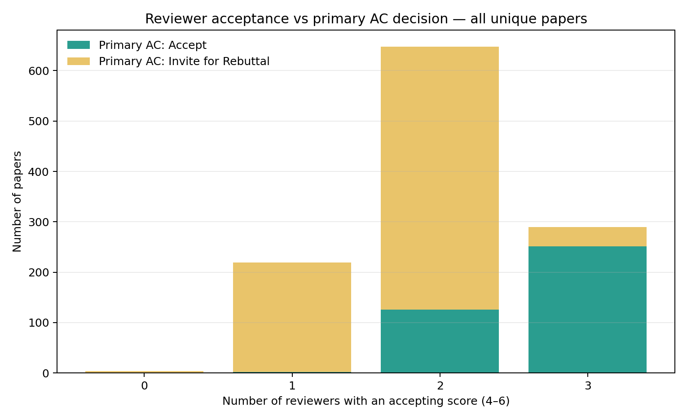
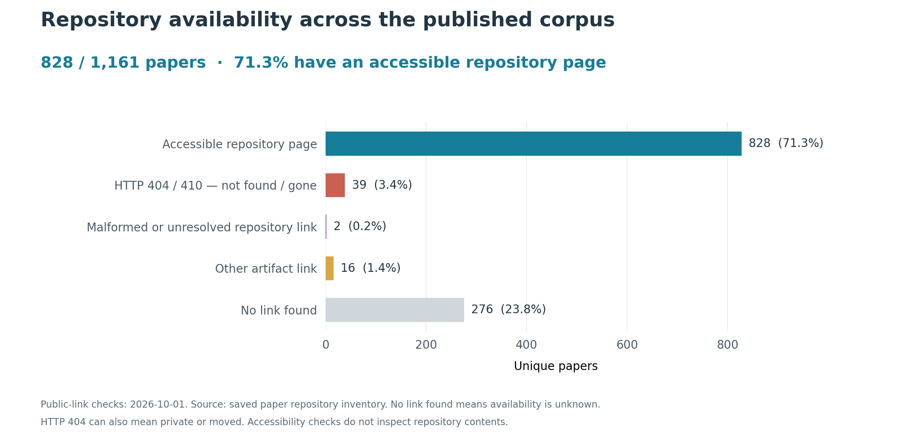

# miccai2026_foragents

This project maps MICCAI 2026 medical-imaging papers, reviews, and shared
research artifacts across modalities and clinical applications.

See [AGENTS.md](AGENTS.md) for repository conventions and
[docs/PROJECT_MEMORY.md](docs/PROJECT_MEMORY.md) for the current analysis state.

## Research reasoning skills

Three Codex skills help turn a paper into a concise briefing, an evidence audit,
and a decisive follow-up experiment:

| Question | Skill |
| --- | --- |
| Understand this paper in one minute. | [`understand-paper-one-minute`](.agents/skills/understand-paper-one-minute/SKILL.md) |
| What contribution is actually supported? | [`what-contribution-is-supported`](.agents/skills/what-contribution-is-supported/SKILL.md) |
| What experiment would change the conclusion? | [`experiment-that-changes-conclusion`](.agents/skills/experiment-that-changes-conclusion/SKILL.md) |

### Get started

Clone the repository and open its root folder in Codex. The skills under
`.agents/skills/` are available in that project without a separate install:

```bash
git clone https://github.com/maystroh/miccai2026_foragents.git
cd miccai2026_foragents
```

In a Codex chat, ask for a skill by name and provide a paper or its stable ID:

```text
Use the understand-paper-one-minute skill on papers/<paper-id>.
Use the what-contribution-is-supported skill on papers/<paper-id>.
Use the experiment-that-changes-conclusion skill on papers/<paper-id>.
```

In Codex CLI or the IDE extension, `/skills` lists available skills and `$` can
mention one directly, for example `$understand-paper-one-minute`. If a paper is
not in the repository, provide a lawful copy or link. The skills state when
their analysis is limited to an abstract or metadata.

To use the skills in *any* Codex project, clone the repository as above, then
copy its three skill folders into your personal skills directory:

```bash
mkdir -p ~/.agents/skills
cp -R .agents/skills/* ~/.agents/skills/
```

On Windows PowerShell, use this equivalent from the cloned repository root:

```powershell
New-Item -ItemType Directory -Force "$HOME/.agents/skills" | Out-Null
Copy-Item -Recurse -Force .agents/skills/* "$HOME/.agents/skills/"
```

See the [skill guide](docs/RESEARCH_SKILLS.md) for the shared evidence rules and
the [skill ideas](docs/RESEARCH_SKILL_IDEAS.md) for community contributions.

## Reviewer acceptance summary

The chart below summarizes the number of reviewers assigning an accepting score
(4–6) for each unique paper, together with the corresponding primary AC
decision. It highlights how AC reviewers used rebuttal invitations when the
initial reviewer consensus was weak.



| Accepting reviewers | Papers | Invite for rebuttal | Rebuttal rate |
|---:|---:|---:|---:|
| 1 | 219 | 217 | **99.09%** |
| 2 | 648 | 522 | **80.56%** |
| 3 | 290 | 39 | **13.45%** |

The steep decline suggests that AC judgment matters most when reviewer support
is divided; these are descriptive associations, not proof that reviewer counts
alone caused the decision.

Four papers received no accepting score from any reviewer, yet the primary AC
decision was **Invite for Rebuttal** for all four:

- [Anatomy- and Site-Guided 3D Patch Diffusion for Robust MRI Harmonization](https://papers.miccai.org/miccai-2026/0052-Paper3157.html)
- [BRAIN: Bi-directional Motion Reasoning with Dynamic Memory Pruning for Surgical Video Segmentation](https://papers.miccai.org/miccai-2026/0116-Paper5179.html)
- [RAPO: Risk-Aware Anatomical Prior Optimization via Reinforcement Learning for CAC Detection in Rheumatoid Arthritis](https://papers.miccai.org/miccai-2026/0855-Paper1391.html)
- [Surgical Video Temporal Grounding](https://papers.miccai.org/miccai-2026/1013-Paper4572.html)

The underlying per-paper summary is available in
[`reports/review_acceptance/acceptance_summary.csv`](reports/review_acceptance/acceptance_summary.csv).

## Repository availability

**828 of 1,161 published papers (71.32%)** have publicly accessible repository
pages, based on checks from October 1, 2026. Repository code has not been analyzed.

[](reports/repository_availability/overall_availability.png)

See the [full repository availability analysis](reports/repository_availability/README.md)
for all charts, modality comparisons, artifact classifications, and paper-level data.
