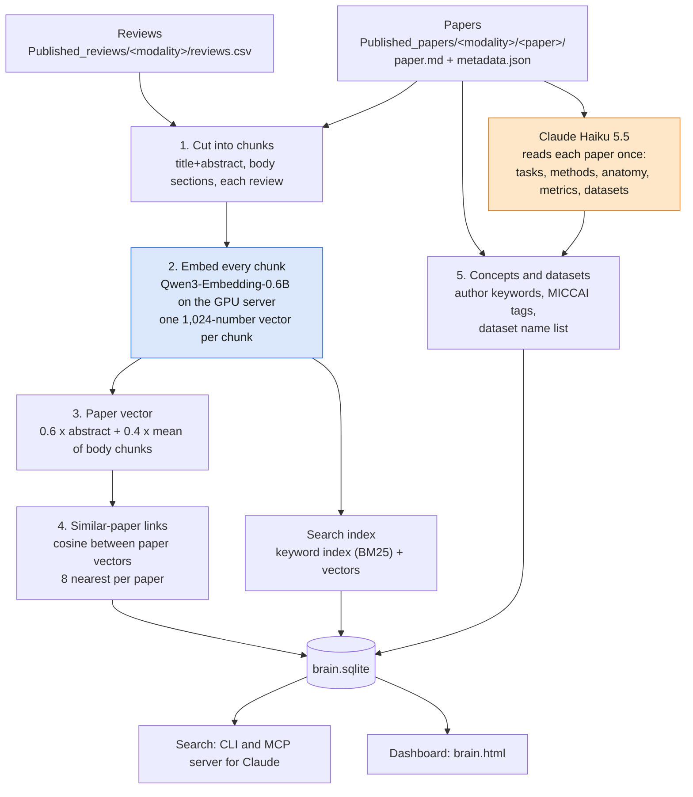
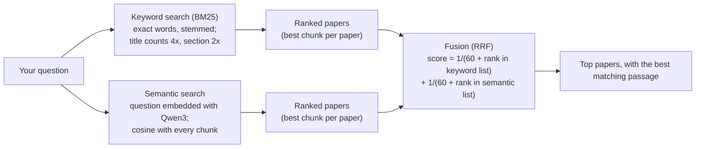
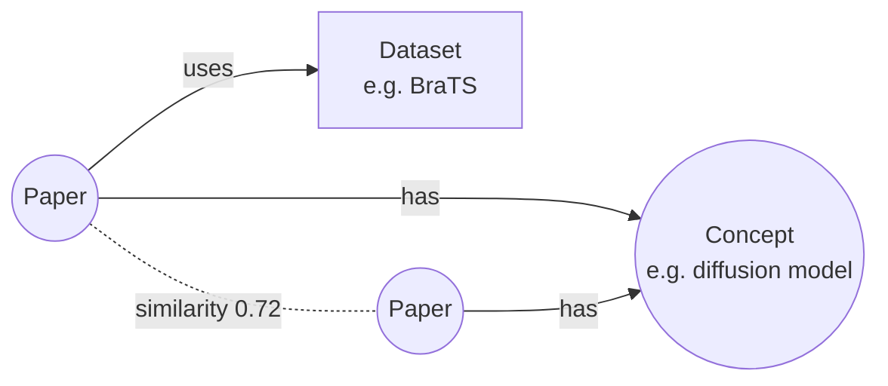

# MICCAI brain

A searchable map of all 1,161 MICCAI 2026 papers and their reviews, inspired by
[gbrain](https://github.com/garrytan/gbrain). You can ask it questions in plain English
("missing MRI modalities in brain tumor segmentation") and explore a graph of papers,
concepts and datasets per modality. Code: `src/miccai_brain/`.

Current build: 1,161 papers, 33,341 text chunks, 1,730 concepts, 1,335 datasets and
6,871 similar-paper links. Embeddings come from Qwen3-Embedding-0.6B; concepts were
extracted with Claude Haiku 5.5 (total cost $1.49).

## How the brain is built



Blue is the step that runs on the GPU server and orange is the only step that uses an LLM.
Everything else is plain Python on your PC.

### 1. Chunks

A paper is too long to compare as one block, so it is cut into chunks:

- **Title + abstract**: one chunk per paper.
- **Body**: the parsed `paper.md` without the references, watermark and image links, split at
  its headings. Short sections are merged; long ones are cut into windows of about
  1,800 characters that overlap by 200, so a sentence is never lost at a cut.
- **Reviews**: one chunk per reviewer (strengths and weaknesses together, with the rating),
  plus the authors' rebuttal and the meta-review. Reviews are searchable only when you ask
  (`--reviews`), so they never push papers aside in normal searches.

### 2. Embeddings (what "semantic" means here)

Each chunk is turned into a list of 1,024 numbers (a *vector*) by
**Qwen3-Embedding-0.6B**, running on the 5090 of the GPU server. Texts with a similar
meaning get vectors that point in a similar direction, even when they use different words
("incomplete modalities" and "missing sequences"). Vectors are cached by the hash of their
text, so a rebuild only embeds what changed.

### 3. Paper vector

Each paper gets one vector: **0.6 x the title/abstract vector + 0.4 x the average of its
body chunk vectors**, rescaled to length 1. The abstract weighs more because it states what
the paper is about; the body adds method and dataset detail.

### 4. Similarity score (the links between papers)

The **similarity** between two papers is the cosine of the angle between their paper
vectors: the closer to 1, the closer the topic. For example, the closest papers to
`0002-Paper5533` score between 0.63 and 0.66. Each paper is linked to its **8 most similar papers**. The dashboard
slider (default 0.60) hides weaker links.

### 5. Concepts and datasets

A **concept** is a short lowercase term that papers share. It comes from three places:

| Source | Example | Kind shown in the dashboard |
|---|---|---|
| The authors' own keyword line in the paper | "multiple sclerosis" | Author keyword |
| MICCAI's Body / Applications / Machine Learning tags | "brain", "computer-aided diagnosis" | MICCAI tag |
| Claude Haiku 5.5 | task "brain tumor segmentation", method "diffusion model", anatomy "heart", metric "dice score" | Extracted task, method, anatomy, metric |

Synonyms are merged with `inputs/concept_aliases.csv` (for example "cnns" becomes "cnn").
Metrics and MICCAI tags are hidden by default in the dashboard because almost every paper has
them; tick "MICCAI tags and metrics" to show them.

A **dataset** is found two ways: a regular-expression list of well-known datasets
(`inputs/datasets.csv`, e.g. BraTS, ADNI, UK Biobank) matched in the abstract and body, and the
public datasets Haiku lists. Haiku's names are mapped to the list's spelling when they match.
Private in-house cohorts are left out.

### Where Claude Haiku 5.5 is used

Only in step 5, once per paper (`python -m src.miccai_brain extract`). Haiku reads the
title, modalities, author keywords, abstract and the first 24,000 characters of the cleaned
paper, and returns JSON with:

- `tasks`, `methods`, `anatomy`, `metrics`: become concepts in the graph;
- `datasets` (name, public or not, train or eval): become dataset nodes;
- `contributions`, `limitations`: kept in `reports/miccai_brain/llm/<paper>.json` for later use,
  not shown in the graph yet.

Each answer is cached, so a rebuild never calls Haiku again. The run over all 1,161 papers
cost **$1.49** (about $0.0013 per paper; 11.5M input and 0.7M output tokens). The
`--max-cost` option stops the run at a budget (default $5).

Haiku is **not** used for search, similarity or embeddings.

## How search ranks papers



- **Keyword search (BM25)** finds the exact words of your question. A rare word that appears
  often in a chunk scores high; "segmentation" counts for less than "QSM" because almost every
  paper says "segmentation".
- **Semantic search** compares the meaning of your question with every chunk vector, so it also
  finds papers that use other words.
- **Fusion (reciprocal rank fusion)** keeps only the rank of each paper in each list, not the raw
  scores, and adds `1 / (60 + rank)` from both lists. A paper ranked 1st in both gets
  2/61 = 0.0328, the highest possible score; a paper found by only one list scores at most 1/61 =
  0.0164. So papers that both methods agree on rise to the top.
- `--modality MRI` limits both lists to that topic before ranking.

## What you see in the graph



- **Topic** = a modality folder (`MRI`, `EHR`, `Diffusion-MRI`, ...). A paper listed under several
  modalities in `deduplication_map.csv` appears in each of them.
- **Paper** (dot, coloured by modality in the "All topics" view): click it for its abstract,
  concepts, datasets and 10 most similar papers.
- **Concept** (grey dot) and **dataset** (orange square): sized by how many papers use them. Only
  concepts used by at least N papers are drawn (slider, default 3).
- **Lines**: solid grey lines are similar-paper links above the similarity slider; faint lines
  join a paper to its concepts and datasets.
- **Top concepts / datasets here**: counts for the selected topic.

## Run

Run from the miccai2026 folder (it needs `Published_papers/<modality>/<paper>/` folders).

Settings can live in the `.env` of the miccai2026 folder (the CLI reads it).

```bash
# GPU server over SSH running server_embed.py (JSON lines on stdin/stdout); {remote} marks
# where the remote command goes
MICCAI_BRAIN_EMBEDDER=ssh:Qwen/Qwen3-Embedding-0.6B
MICCAI_BRAIN_SSH=wsl.exe -e bash -lc "ssh -o BatchMode=yes -p <port> <user>@<host> '{remote}'"
# optional: embed search queries locally with the same model instead of over SSH
MICCAI_BRAIN_QUERY_EMBEDDER=sentence-transformers:Qwen/Qwen3-Embedding-0.6B
OPENROUTER_API_KEY=...
```

Other embedders:

```bash
# OpenAI-compatible /v1/embeddings server (vLLM, TEI, ...)
export MICCAI_BRAIN_EMBEDDER="openai:Qwen/Qwen3-Embedding-4B"
export MICCAI_BRAIN_EMBED_URL="http://<server>:<port>/v1"
export MICCAI_BRAIN_EMBED_KEY_VAR=""            # name of the env var holding the key, if any

# optional: LLM extraction via OpenRouter, cached in reports/miccai_brain/llm/
export MICCAI_BRAIN_LLM_KEY_VAR="OPENROUTER_API_KEY"
python -m src.miccai_brain extract --model anthropic/claude-haiku-5.5 --limit 20   # pilot
python -m src.miccai_brain extract --model anthropic/claude-haiku-5.5              # all papers

python -m src.miccai_brain build              # writes brain.sqlite and brain.html here
python -m src.miccai_brain search "missing modality brain tumor segmentation" -m MRI
python -m src.miccai_brain search "limited novelty" --reviews
python -m src.miccai_brain related 0002-Paper5533
python -m src.miccai_brain topic EHR
python -m src.miccai_brain concept BraTS -m MRI
```

Ollama also works (`MICCAI_BRAIN_EMBEDDER=ollama:<model>`), as does a local
sentence-transformers model (`sentence-transformers:BAAI/bge-small-en-v1.5`). Re-running
`build` reuses cached embeddings for unchanged text. Qwen3-Embedding models get their query
instruction automatically; override it with `MICCAI_BRAIN_QUERY_PREFIX`.

## Claude / MCP

```bash
claude mcp add miccai-brain -- python -m src.miccai_brain serve
```

Tools: `search_papers`, `get_paper`, `related_papers`, `list_topics`, `topic_overview`,
`papers_with`.

## Dashboard

`brain.html` is self-contained (data inlined; the graph library loads from jsDelivr). Pick a
topic, filter by text, click a paper for its abstract, concepts, datasets and nearest
neighbours, or click a concept/dataset for its papers.

## Inputs

- `inputs/datasets.csv`: dataset vocabulary (name, regex). Add rows to catch more datasets.
- `inputs/concept_aliases.csv`: merges synonyms (e.g. `cnns` -> `cnn`).
